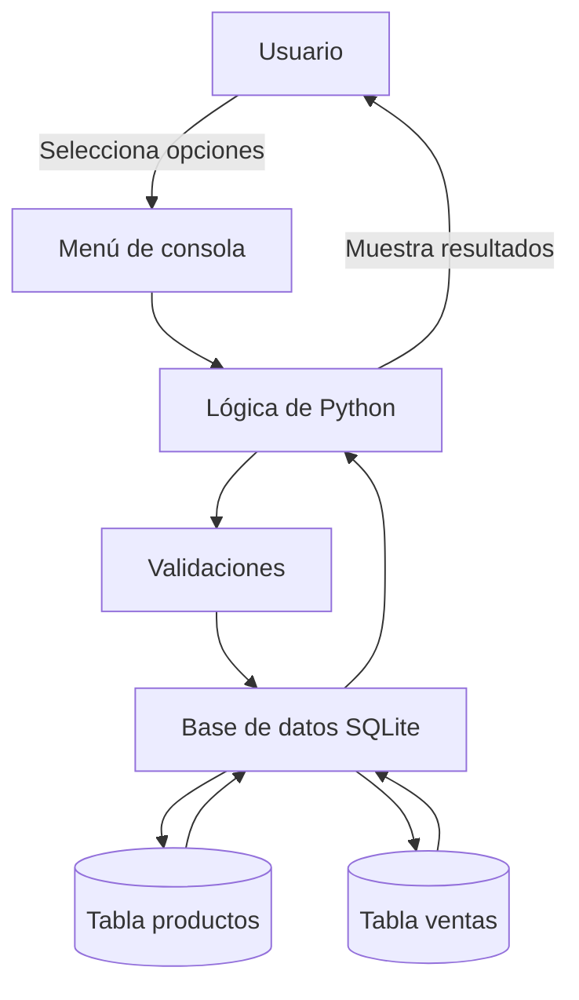

# Diagrama de arquitectura

## Componentes del sistema

El sistema utiliza una arquitectura sencilla de tres componentes:

- **Usuario:** interactúa con el menú de consola.
- **Python:** procesa las opciones, valida los datos y ejecuta las operaciones.
- **SQLite:** almacena los productos y las ventas.

## Diagrama



## Funcionamiento

El usuario selecciona una opción del menú. Python procesa la solicitud, valida los datos y ejecuta consultas SQL parametrizadas sobre SQLite.

Al registrar una venta, se comprueba la existencia del producto y el stock disponible. Después se registra la venta y se descuenta el inventario dentro de una transacción. Si ocurre un error, se utiliza `rollback()`; si todo sale bien, se confirma con `commit()`.
```