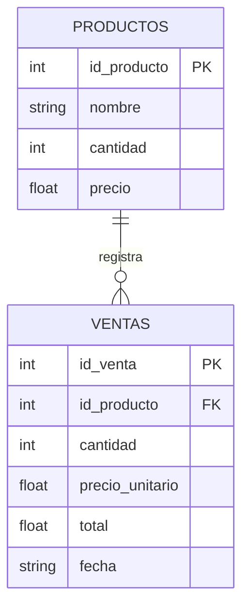
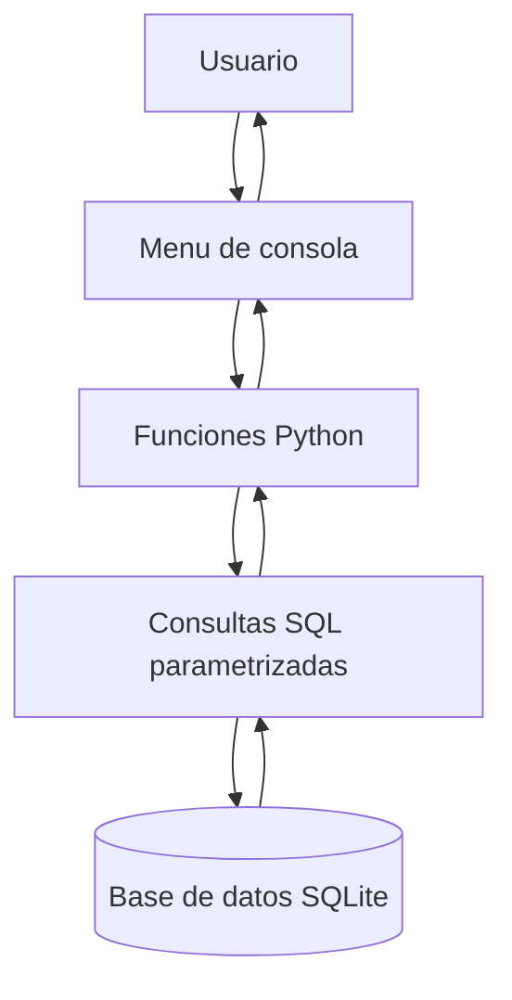

# Sistema de Inventario y Ventas

## 1. Descripción del proyecto

Aplicación de consola desarrollada en Python para administrar
productos y registrar ventas utilizando SQLite.

El sistema permite realizar operaciones CRUD sobre los productos,
consultar el historial de ventas y mantener la consistencia del
inventario mediante transacciones.

## 2. Entidades y atributos

### Tabla productos
- id_producto: clave primaria.
- nombre: nombre del producto.
- cantidad: existencias disponibles.
- precio: precio unitario.

### Tabla ventas
- id_venta: clave primaria.
- id_producto: clave foránea relacionada con productos.
- cantidad: unidades vendidas.
- precio_unitario: precio al momento de la venta.
- total: importe total de la venta.
- fecha: fecha y hora de la operación.

## 3. Modelo de datos

## 4. Arquitectura del sistema

## 5. Registro de ventas y transacciones

Al registrar una venta, el programa:

1. Verifica que el producto exista.
2. Comprueba que haya suficientes unidades.
3. Inicia una transacción.
4. Registra la venta y descuenta el inventario.
5. Ejecuta commit() si todo funciona correctamente.
6. Ejecuta rollback() si ocurre un error.

La transacción evita que se guarde una venta sin descontar
las unidades correspondientes.

## 6. Prueba de rollback

Se provoca un error controlado durante el registro de una venta.
Después se consulta el inventario y el historial de ventas.

La prueba es correcta cuando el stock y el número de ventas
permanecen iguales a los valores anteriores.

## 7. Tecnologías utilizadas

- Python 3
- SQLite
- Módulo sqlite3
- SQL y consultas parametrizadas

## 8. Instrucciones de ejecución

1. Instalar Python 3.
2. Abrir una terminal en la carpeta del proyecto.
3. Ejecutar:

   python main.py

4. Seguir las opciones del menú.

La base de datos y sus tablas se crean automáticamente.
